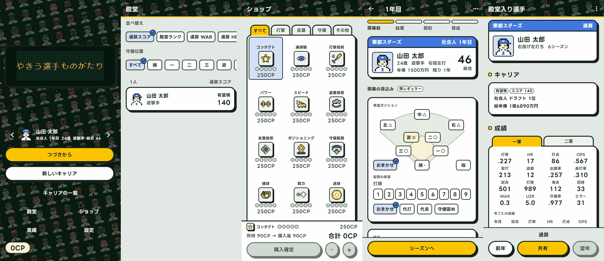

## Problem

ですてにい版（`salan70/baseball_player_journey` の `apps/destiny`）のタイトルに、夜の球場の緑の地に選手の顔が斜めの列で流れる地を入れた（DS-238、[destiny-title-logo](../destiny-title-logo/README.md)）。
他の画面は明るい無地の地（`#F8F9F9`）と灰のままで、行き来すると世界が切り替わり、タイトルだけが浮いて見えた。
利用者は、タイトルは変えずに他の画面を寄せて差を埋めることを求めた（2026-10-16）。

## Target

タイトルから殿堂、ショップ、実績、設定、シーズンへ行き来する人。

## Scope / Domains

対象はタイトル以外の画面の見出しの帯、画面の地、色の token である。
3 段に分けて利用者が選んだ。

- 第 1 段（寄せ方）: 見出しの帯を掲示板の色にする、明るい地に顔の列を薄く敷く、見出しの帯に夜の顔の列を敷く、の 3 案。
- 第 2 段（地の濃さ）: 第 1 段の夜の見出しのまま、地を `#EEF1EE`、`#E2E8E3`、`#D3DCD5` の 3 段。
- 第 3 段（配色）: 夜の球場、掲示板、夜の字から token を組み直す 4 段（地だけ、灰を緑に、面をクリームに、選択を芝の緑に）。

比較は実アプリを撮影テストで描いて行い、Artifact に置いた（第 1、2 段: https://claude.ai/artifact/3mWq2WUBnesFsby9vh7tbT 、第 3 段: https://claude.ai/artifact/MmYijqCdqtQnTUqtZ8tazn ）。

## Constraints

- タイトル画面（並行の作業が題字を直していた）は触らない。
- 主の黄、選択の青、補助の珊瑚、状態の色と、ボタンの黒い縁と影の形は変えない。
- 見出しの帯の顔は、タイトルと同じ部品と同じ並びを使い、流さない（読む画面の後ろで動かさない）。

## Variants

| id                | 仮説                                                               | 変えた軸 | 実装                         |
| ----------------- | ------------------------------------------------------------------ | -------- | ---------------------------- |
| `board-header`    | 見出しを掲示板の色にするだけで、タイトルとのつながりが出る         | 寄せ方   | 削除                         |
| `face-ground`     | 顔の列を薄く敷いた地が、世界観を一番そろえる                       | 寄せ方   | 削除                         |
| `night-header`    | 見出しにタイトルと同じ夜の顔の帯を敷けば、本文を明るく保てる       | 寄せ方   | 製品の `night_app_bar.dart`  |
| `night-header-t1` | 地と灰と輪郭を芝の緑へ寄せると、画面全体がタイトルと同じ空気になる | 配色     | 製品の `destiny_colors.dart` |

## Evaluation

評価の手順は使わず、利用者が比較ページを見て選んだ。

## Decision

`night-header` に、地 `#E2E8E3`（第 2 段の中）と、灰を緑に寄せる配色（第 3 段の T1）を採る（2026-10-16、利用者）。
製品の決定は DS-241 に記録した。

- 見出しの帯: タイトルと同じ顔の列を止めて敷き、掲示板の色の 72% で覆う。題と戻るの印は夜の字、下端に点いた LED の黄の 3 点の線。
- 配色: background `#E2E8E3`、surfaceContainer `#EEF2EE`、surfaceVariant `#D0DAD3`、onSurfaceVariant `#435048`、outline `#6A786F`、字と輪郭と影 `#17221B`。面は白のまま。

## Rejected reasons

- `board-header`: 顔の地とのつながりが弱い。
- `face-ground`: 字だけの欄（設定の説明など）の後ろがうるさくなる。
- 地 `#EEF1EE`: 寄せ方が弱い。`#D3DCD5`: 字だけの欄が重く見える。
- 面をクリームにする段と、選択を芝の緑にする段: 利用者が灰を緑に寄せる段で止めた。

## Learnings

- 1 画面に入れた強い地を他の画面へ広げるときは、地そのものを敷き詰めるより、見出しの帯にだけ敷き、残りは色の token で寄せると読みやすさを保てる。
- 寄せ方、濃さ、配色の段を分けて見せると、利用者は「もう少し」を段で選べる。
