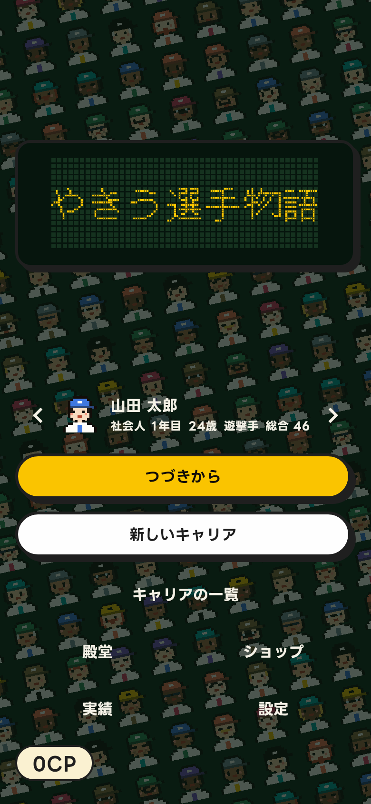

## Problem

ですてにい版（`salan70/baseball_player_journey` の `apps/destiny`）のタイトルは、仮の英字の題字「BASEBALL DESTINY」を電光掲示板に点け、下に「ですてにい」と添えていた。
利用者はアプリ名を「やきう選手物語 / プロ野球選手シミュレーション」で考えており、題字の完成版と、タイトルの地（斜めの芝の帯）の見直しを求めた（2026-10-16）。

## Target

ですてにい版を起動し、タイトルから続きのキャリアへ入る人。
タイトルは起動のたびに数秒見る画面で、題字は名前を覚えてもらう唯一の場所である。

## Scope / Domains

対象はタイトルの題字と地である。
変える軸は 3 段に分けて利用者が選んだ。

- 第 1 段（題字の方向）: 電光掲示板、ポップな題字、球団のエンブレム風、ドット絵の題字の 4 案。
- 第 2 段（掲示板の作り込みと地）: 掲示板は黄 1 色、2 色、筐体と B・S・O のランプの 3 案。地は芝の帯、夜空と照明、刈り込みの市松の 3 案に、ダイヤモンドの俯瞰、客席、ドット絵の夜の球場、夕暮れ、ボールの縫い目の 5 案を足した。
- 第 3 段（動きと顔の地）: 掲示板を 1 列にして流し続ける、1 度流して 2 段で止まる、2 段のまま。地に選手の顔を並べる 3 案（名鑑の壁、斜めに流れる列、まわりに並ぶ）。

比較はタイトル画面の実寸のモックで行い、[previews/compare-round1.html](previews/compare-round1.html)（第 1 段）と [previews/compare.html](previews/compare.html)（第 2、3 段）に残す。

## Constraints

- 夜の球場の色（`NightColors`）とボタンの黒い縁と影を変えない。
- 掲示板の大きさと縁はこれまでと同じにし、画面の他の部品を動かさない。
- 和文の題字は 16 × 16 の 1 点の線で組む。下書きは DotGothic16（OFL）の字形を写し、かなと「物」は線の太さを揃えるために描き直した。
- 動きを抑える設定（OS と製品の設定）では流さない。
- 地の顔は製品の選手の顔（D-37 の 16 点の胸像）をそのまま使い、画像を持たない。

## Variants

| id               | 仮説                                                             | 変えた軸   | 実装                           |
| ---------------- | ---------------------------------------------------------------- | ---------- | ------------------------------ |
| `board`          | いまの掲示板の延長が、球場らしさと読みやすさを両立する           | 題字の方向 | 製品へ移したため削除           |
| `pop`            | 太い縁と影の丸い字が、ボタンと揃って楽しい印象を作る             | 題字の方向 | 削除                           |
| `emblem`         | 白球と帯のエンブレムは、アプリのアイコンにも流用できる           | 題字の方向 | 削除                           |
| `pixel-title`    | 選手の顔と同じドット絵の字が、画面を 1 つの絵にまとめる          | 題字の方向 | 削除                           |
| `ticker-gallery` | 1 列で流れる掲示板と、逆向きに流れる顔の列が、動きと題材を揃える | 動きと地   | 製品の `title_board.dart` ほか |

第 2 段の掲示板の 3 案と地の 8 案、第 3 段の動きの残り 2 案と顔の地の残り 2 案は、比較ページにだけある。

## Evaluation

評価の手順は使わず、利用者が比較ページを見て選んだ。

## Decision

`ticker-gallery` を採る（2026-10-16、利用者）。
製品の決定は DS-238 に記録した。

- 題字: 「やきう選手物語」を 16 点の和文ドットで、47 点の幅の掲示板に 1 列で右から入れて左へ抜き、16 点あけて繰り返す。1 秒に 30 点、1 点ずつ送る。
- 掲示板の下の名前と副題は置かない。
- 地: 架空の選手の顔（40）を -0.21 rad の斜めの列に 46 の間隔で並べ、列ごとに逆向きに 1 秒 14 で流し、掲示板の色の 72% で覆う。
- 動きを抑えるときは、題字の全体を掲示板の幅に収めて止め、顔の地も止める。

## Rejected reasons

- `pop`、`emblem`、`pixel-title`: 利用者が第 1 段で電光掲示板を選んだ。
- 2 色と筐体の掲示板: 1 列で流す案を選んだので、2 段を前提にした色分けとランプの段は要らなくなった。
- 芝の帯、夜空と照明などの景色の地: 利用者が「選手の顔がギャラリーのように並ぶ地」を求め、顔の地から選んだ。
- 1 度流して 2 段で止まる案: 利用者が 1 列の横スクロールを選んだ。題字の全体が一度に見えない点は、流し続けて補う。
- 名鑑の壁: 札の白い面が明るく、覆っても字とボタンが沈む。まわりに並ぶ案: 動きが無く、流れる掲示板と揃わない。

## Learnings

- 題字の方向を先に 1 つ選んでもらい、作り込みと地を別の軸に分けると、利用者は案を足して広げる方向へ進めやすい（今回は地を 3 案から 11 案へ広げた）。
- ブランドの題字でも、題材の固有の要素（選手の顔）を地に使う案が最後に選ばれた。比喩は制作側が出す案より、利用者の一言から決まることがある（`crafting-svg` の「比喩と印象は依頼者と決める」と一致）。

## Related

- 製品: `salan70/baseball_player_journey` の `docs/destiny/specification/decisions.md` DS-238、`docs/destiny/design/ux/start_career.md` のタイトル
- [baseball-journey-app](../baseball-journey-app/README.md)
